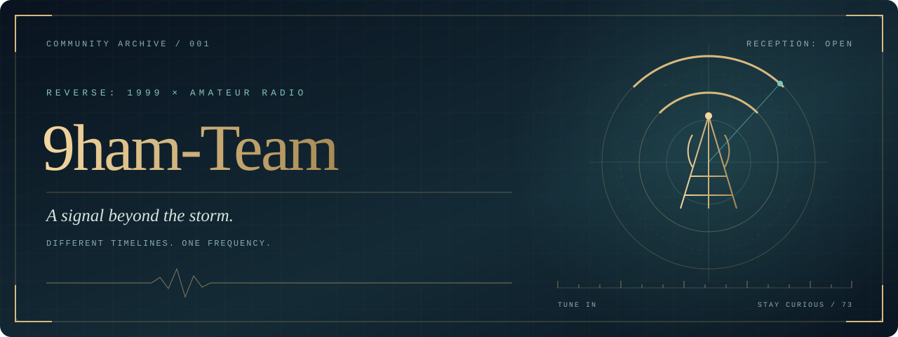

 

### 当暴雨之外，仍有信号。

一群《重返未来：1999》玩家，也是一群业余无线电爱好者。 
我们在故事与电波的交汇处相遇，把共同的好奇心，写进同一个 GitHub 组织。

**不同的时间线，同一个频率。**

[认识我们](#01--接收信号) · [探索频段](#02--转动调谐旋钮) · [建立连接](#03--建立连接) · [组织主页](https://github.com/9ham-Team)

---

## 01 / 接收信号

> **CQ CQ CQ — 这里是 9ham-Team。** 
> 如果你也在“暴雨”的故事里驻足，在电台的底噪里等待回应，欢迎来到我们的频率。

**9ham-Team** 是由 **《重返未来：1999》玩家与业余无线电爱好者的交集人群** 建立的 GitHub 组织。

我们喜欢游戏里的时代气息、人物与叙事，也喜欢现实世界里的天线、传播与通联。一个让我们想象时间的另一种走向，一个让我们亲手探索信号如何抵达远方。而 GitHub，让这些兴趣有了可以一起记录、制作和分享的地方。

这里可以收藏灵感，也可以拆解问题；可以聊一段让人难忘的剧情，也可以研究一次令人惊喜的接收。让热爱留下痕迹，让想法有机会成为作品，是我们相聚于此的理由。

 

**故事给予想象，电波建立连接，开源让灵感延续。**

STORIES INSPIRE · RADIO CONNECTS · OPEN SOURCE CONTINUES

 

## 02 / 转动调谐旋钮

我们的兴趣，可以在这些频段相遇。它们是值得一起探索的方向，也欢迎新的灵感加入。

| 频段 | 接收内容 | 可以一起做的事 |
| :--- | :--- | :--- |
| **`01` · 暴雨档案** | 《重返未来：1999》的世界、角色与时代美学 | 整理资料、交流理解、分享同人创作的灵感 |
| **`02` · 空中电波** | 业余无线电、天线、传播与通联 | 记录实验、分享学习笔记、讨论技术问题 |
| **`03` · 开源工坊** | 代码、文档与实用工具 | 把重复的工作写成工具，把走过的弯路整理成指南 |
| **`04` · 交汇频率** | 两种兴趣碰撞出的新点子 | 尝试电台主题设计、跨兴趣创作与有趣的小实验 |

<b>▸ 打开一张来自交汇频率的灵感卡</b>

 

假如把一份技术笔记，写成一页复古电台档案；把一次接收实验，整理成一段可复现的探索记录；或者为日常使用的小工具，添上一点熟悉的时代美学——两个看似遥远的爱好，就有了共同的作品。

这些都是可以从一个 Issue、一份草稿或几行代码开始的事。

## 03 / 建立连接

不论你更熟悉哪一边，都可以从自己感兴趣的地方开始。会写代码很好，愿意整理资料、认真提问、提供反馈，同样有价值。

| 你带来的信号 | 一种参与方式 |
| :--- | :--- |
| **一个想法** | 在相关仓库的 Issue 中描述它的用途，以及你希望一起解决的问题 |
| **一次发现** | 提供清楚的现象、复现过程或参考资料，让其他人能够接着探索 |
| **一份作品** | 按仓库的贡献说明提交 Pull Request，分享代码、文档或设计 |
| **一段经验** | 把学习过程、实验条件和结论写下来，让下一位同好更容易上手 |

从 [**9ham-Team 的公开仓库**](https://github.com/orgs/9ham-Team/repositories) 开始，找到与你同频的内容。参与具体项目时，请以各仓库的 README、贡献说明与许可证为准。

### 让每一次回应都清晰友善

- **尊重彼此。** 对作品和技术认真，对交流中的人保持耐心。
- **标明来源。** 分享资料与创作时尊重原作者、版权和相应许可。
- **照顾阅读体验。** 讨论关键剧情前标注剧透，让尚未抵达的朋友保留惊喜。
- **认真对待实验。** 进行无线电活动时遵守所在地法规、执照要求与操作规范。

---

### 频率已对准，等待你的回应。

无论你是循着故事而来，还是追着电波抵达， 
愿我们都能在这里，找到值得一起探索的下一件事。

**73 · 9ham-Team** 
“73” 是业余无线电通联中常用的祝福，意为“致以最好的祝愿”。

 

由爱好者相聚而成的非官方社区，与《重返未来：1999》官方无隶属关系。 
《重返未来：1999》及相关名称、角色与素材的权利归各自权利人所有。

